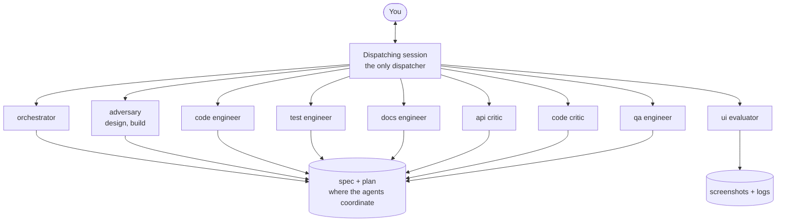
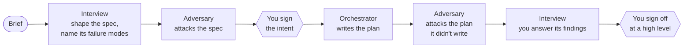
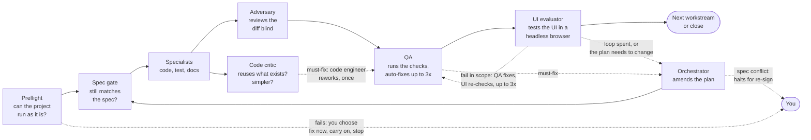

# harness

Spec-driven development with a small team of agents. You sign a one-page spec. A planner turns it into workstreams.
Each workstream is built, attacked by a reviewer that never saw the reasoning behind it, and verified before the next
one starts.

```
/plugin marketplace add gjkoplik/skills
/plugin install harness@gjkoplik
```

Claude Code only: it depends on subagents. To try unreleased changes from a checkout, run
`claude --plugin-dir ./plugins/harness`.

## Using it

Four stages, each ending at a point where you decide something. Start one by typing its command or by asking for it
in words ("run the harness spec stage on ..."), which is easier if you dictate.

| Command | You give it | It ends when |
| --- | --- | --- |
| `/harness:spec <request>` | what you want | you sign the spec |
| `/harness:plan` | a signed spec | you accept the plan, from a summary in chat |
| `/harness:build` | an accepted plan | every workstream has passed |
| `/harness:close` | "I'm ready to merge" | the spec and plan are archived |

The spec and plan live in your project at `specs/<slug>/`, and move to `specs/archive/<slug>/` at close. Ideas that
come up along the way and are not part of the spec are written to `specs/ideas/` as they come up, so they outlive the
conversation; one that is later picked up or dropped is archived with its outcome, not deleted.

## How it is put together

The session you talk to is the hub. It dispatches every agent, relays what comes back, and keeps the record. It
writes no product code and reviews nothing itself, and no agent dispatches another.



### The design loop



### The engineering loop



## Models

Agents are pinned so that the model you choose for your session is spent where it matters and nowhere else.

| Runs on | Agents |
| --- | --- |
| Your session's model | the hub itself, `orchestrator`, `design-adversary` |
| Opus | `build-adversary`, `code-critic`, `code-engineer`, `test-engineer`, `docs-engineer`, `api-critic`, `qa-engineer` |
| Sonnet | `ui-evaluator` |

So the strongest model you are willing to pay for goes on the interview, the spec, the plan and the attacks on
both, and the build runs on Opus whatever your session is on. The UI evaluator is the one agent pinned down a tier,
because browser testing is the most token-hungry thing here and the least in need of deep reasoning.

The hub is the part that is not pinned. During a build it relays every report, so a long build on an expensive
session model is where the spend goes. The stages keep their state in `specs/`, not in the conversation, so a
reasonable pattern is to run `spec` and `plan` on your strongest model and start a fresh session on Opus for
`build`.

A pin is a default. Ask for an agent on a different model and the hub will dispatch it that way.

## What it insists on, and why

Most of what the agents do is left to their judgment. A few things are fixed, because they are about structure and
not about how capable the model is:

- **Only you sign the spec**, and any change to what a signed spec promises stops the work until you re-sign. The
  failure this prevents is the outcome getting quietly smaller while everything stays green.
- **Review comes from a context that was not in the room.** The session that wrote something will agree with it. The
  adversary reads only the artifact, and after a build its counterpart sees the diff and the contract before it sees anyone's
  account of the work.
- **Working is not the same as worth keeping.** A second reviewer reads each build as its future maintainer: did it
  reuse what was already there, follow the structure the plan agreed, keep the user-facing surface to what the spec
  shows, and stay as small as the job. It can only block on something it can point at.
- **You name the failure modes.** A list the model wrote has the model's blind spots.
- **One dispatcher.** Everything returns to the session you are in, so there is one place to watch and one place to
  stop it.
- **Loops are bounded.** QA fixes for three rounds, the UI loop runs three rounds, a workstream gets two plan
  amendments, and then it comes to you.

## What it does not do

- It keeps no knowledge base and no per-agent memory. The archived specs and ideas are the record.
- It has no branching strategy beyond one working branch with a commit per workstream, and it never pushes or merges
  unless you ask at close.
- It does not sync an issue tracker.
- It does not load itself or advance itself. Each stage runs when you ask for it.
